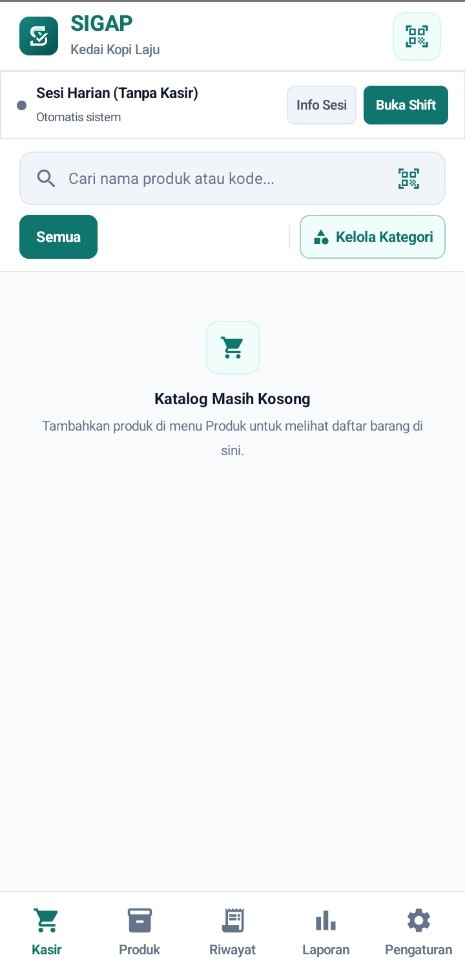
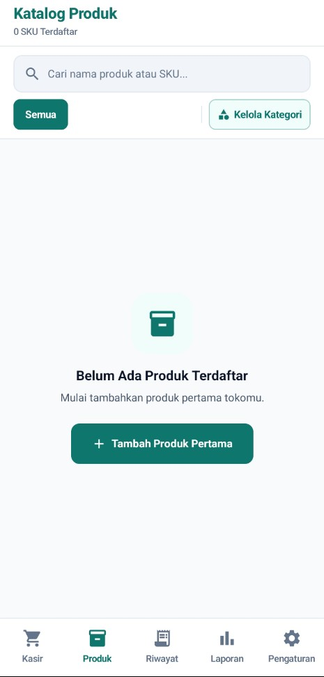
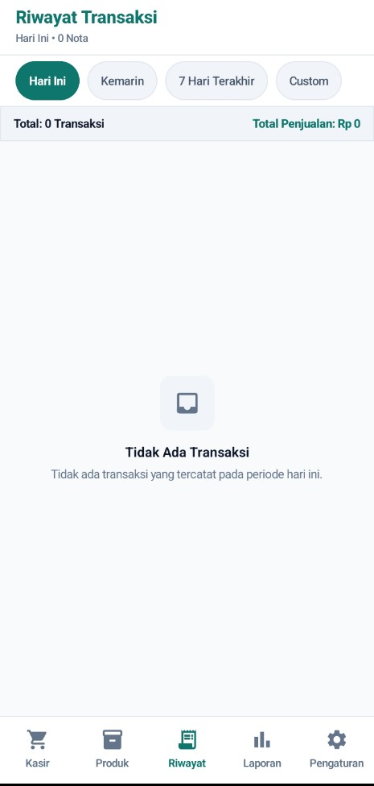
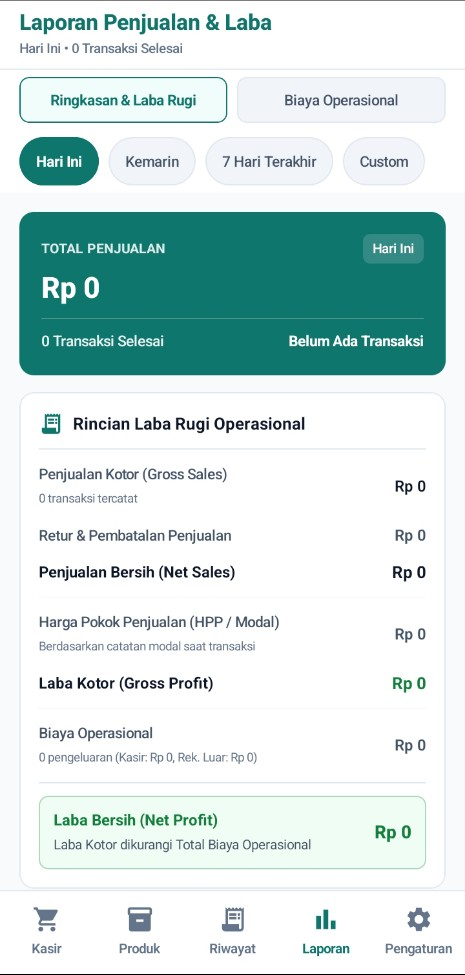
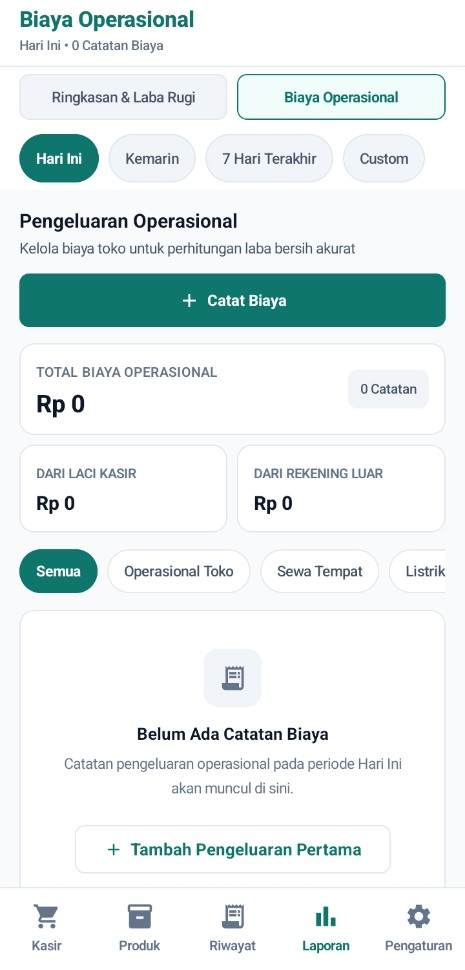
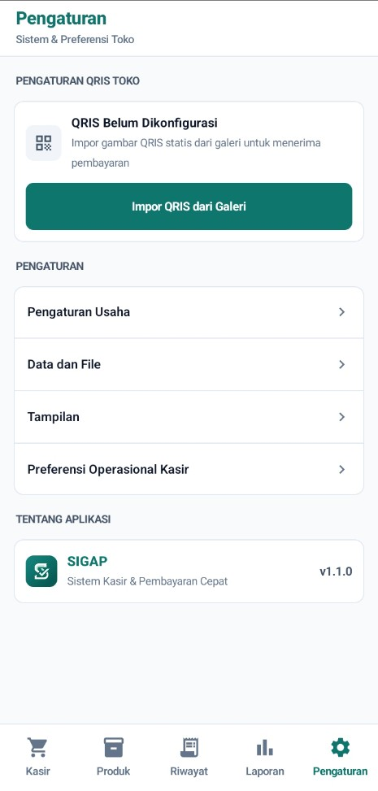

<p align="center">
  
</p>

# SIGAP POS

SIGAP adalah aplikasi kasir Android untuk UMKM. Kamu bisa mencatat transaksi, mengelola produk dan stok, melacak shift kasir, mencatat biaya operasional, serta melihat laporan laba rugi. Seluruh data usaha disimpan secara lokal di perangkat, sehingga fitur kasir inti dapat digunakan penuh tanpa koneksi internet.

## Download

**[Download SIGAP v1.1.0 APK](https://github.com/adlnfkhrzmn/sigap-app/releases/download/v1.1.0/SIGAP.apk)**

- **Versi**: 1.1.0 (Rilis Resmi)
- **Target Sistem**: Android 8.0 (API level 26) atau lebih baru
- **Ukuran Berkas**: ~13,58 MB (`13.583.041` bytes)

Lihat [catatan rilis](RELEASE_NOTES.md) untuk rincian pembaruan versi 1.1.0 dan riwayat versi sebelumnya.

### Rilis SIGAP v2.0.0 (Tahap Persiapan Distribusi / Release Candidate)

SIGAP v2 menghadirkan kapabilitas deteksi notifikasi pembayaran QRIS otomatis, perbaikan identitas usaha instalasi baru, pembersihan keranjang otomatis, dan pelaporan bug mandiri.

- **Status:** Release Candidate (Tahap Persiapan Rilis)
- **Tautan Unduhan v2:** Menunggu publikasi rilis resmi di GitHub Releases (belum aktif)
- **Dokumentasi & Berkas v2:** Silakan merujuk ke folder [v2/](v2/README.md) untuk dokumentasi lengkap v2, panduan pengguna, kebijakan privasi, panduan Play Protect, serta berkas rilis v2.

## Screenshot Aplikasi

<table>
  <tr>
    <td align="center"><strong>Kasir</strong><br></td>
    <td align="center"><strong>Produk</strong><br></td>
  </tr>
  <tr>
    <td align="center"><strong>Riwayat Transaksi</strong><br></td>
    <td align="center"><strong>Laporan Laba Rugi</strong><br></td>
  </tr>
  <tr>
    <td align="center"><strong>Biaya Operasional</strong><br></td>
    <td align="center"><strong>Pengaturan</strong><br></td>
  </tr>
</table>

## Fitur Utama

- **Kasir & Shift:** Pencarian produk instan, navigasi kategori, pengaturan kuantitas/catatan, manajemen shift/sesi kasir, dan pembayaran terpisah (split-payment tunai + QRIS).
- **Produk & Stok:** Kelola katalog, kategori, harga jual dan modal, indikator stok menipis, dan unduh lembar kerja stock opname.
- **Koreksi & Retur:** Pembatalan nota transaksi dan retur produk per item (restock kembali ke toko atau scrap rusak) dengan perhitungan pengembalian dana proporsional berdasarkan harga efektif item.
- **Biaya & Laba Rugi:** Pencatatan pengeluaran operasional toko (memotong kas laci atau rekening luar) serta laporan laba rugi bersih yang transparan.
- **Diskon & Barcode:** Diskon per produk (persen/nominal), rincian diskon pada struk, serta pemindaian barcode kamera langsung di perangkat.
- **Riwayat & Laporan:** Filter periode ringkas (Hari Ini, Kemarin, 7 Hari Terakhir, Custom), cetak struk via printer/PDF, dan ringkasan penjualan harian.
- **Spreadsheet & Cadangan:** Ekspor-impor data Excel multi-lembar dan paket CSV dengan validasi integritas relasional, unduh template impor, serta backup dan restore data lokal Room.

## Catatan Penting

- **QRIS:** SIGAP membuat QR dinamis secara lokal di perangkat. Kasir tetap harus memastikan pembayaran benar-benar masuk melalui aplikasi merchant sebelum menyelesaikan transaksi.
- **Data usaha:** Seluruh data disimpan secara lokal di perangkat Anda. Disarankan untuk mencadangkan data secara berkala melalui menu Pengaturan, terutama sebelum memperbarui atau mencopot aplikasi.

## Instalasi

Ikuti [Panduan Instalasi APK](INSTALASI_APK.md) untuk petunjuk pemasangan berkas APK dan penanganan peringatan keamanan Android.

## Verifikasi Integritas APK

Pastikan checksum berkas APK yang diunduh sesuai dengan nilai resmi berikut:

**SHA-256**

```
1cd255abc749bd25a46610a9d12fcd954c9cf0fca62f98fd040741acb0267573
```

Di Windows PowerShell, jalankan perintah berikut pada folder tempat berkas disimpan:

```powershell
Get-FileHash .\SIGAP.apk -Algorithm SHA256
```

Nilai hash harus sama persis dengan yang tercantum di atas.
